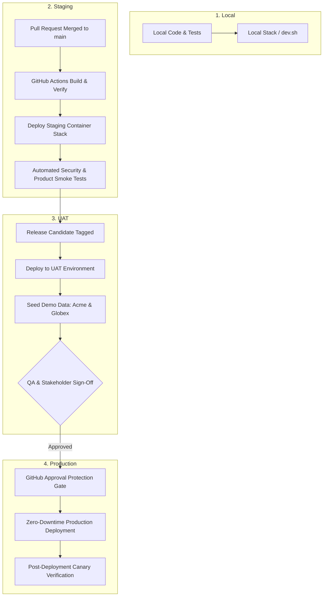

# Karmarat Multi-Tier Environment Lifecycle

This document defines the formal four-tier promotion lifecycle for Karmarat: **Local**, **Staging**, **UAT (User Acceptance Testing)**, and **Production**.

---

## 1. Overview & Tier Comparison

| Characteristic | Local (`local`) | Staging (`staging`) | UAT (`uat`) | Production (`production`) |
| :--- | :--- | :--- | :--- | :--- |
| **Primary Domain** | `karmarat.local` | `staging.karmarat.com` | `uat.karmarat.com` | `karmarat.com` |
| **Tenant Routing** | `{slug}.karmarat.local` | `{slug}.staging.karmarat.com` | `{slug}.uat.karmarat.com` | `{slug}.karmarat.com` |
| **Ingress & TLS** | Caddy `internal` (self-signed) | Wildcard Let's Encrypt (DNS-01) | Wildcard Let's Encrypt (DNS-01) | Wildcard Let's Encrypt + HSTS |
| **Audience** | Software Developers | Automated CI & Engineers | QA, Product Managers, Pilots | Real Employers & Candidates |
| **Deployment Trigger** | `make dev` or `make prod-up` | Auto on merge to `main` | Tagged releases (`release-*`) | Manual approval gate in GitHub |
| **Database State** | Ephemeral or local volume | Auto-migrated test DBs | Seeded realistic demo tenants | Live persistent cluster + PITR |
| **Email Delivery** | Mailpit (captured locally) | Mailtrap / Sandbox SMTP | Real emails to `@karmarat.com` | Live transactional (Resend/SES) |
| **Payments (Stripe)** | Test keys / Mock provider | Stripe Test Mode (`sk_test_...`) | Stripe Test Mode with webhooks | Stripe Live (`sk_live_...`) |
| **Log Level** | `debug` | `info` | `info` | `warn` / `error` |

---

## 2. Environment Architecture & Promotion Flow



---

## 3. Tier Specifications

### Tier 1: Local (`local.env.example`)
* **Goal**: Instant developer feedback and hot-reloading.
* **Network**: Docker internal bridge network or host processes (`./scripts/dev.sh`).
* **Storage**: Local MinIO container with sample buckets.
* **Email**: Mailpit captures all outbound emails; no external emails leave the machine.

### Tier 2: Staging (`staging.env.example`)
* **Goal**: Continuous automated integration and boundary verification.
* **Infrastructure**: Cloud VPS or staging Kubernetes namespace running the full containerized stack.
* **Automation**: Every merge to `main` triggers container builds, deploys to Staging, and executes:
  - `scripts/smoke.sh` (Security boundary checks)
  - `scripts/smoke-product.sh` (End-to-end recruitment lifecycle checks)
* **Data Persistence**: Test databases may be reset or re-migrated at any time.

### Tier 3: UAT / Pre-Production (`uat.env.example`)
* **Goal**: User acceptance testing, product sign-offs, and enterprise customer demonstrations.
* **Infrastructure**: Strict production replica with identical resource sizing and configuration flags (`COOKIE_SECURE=1`).
* **Seeding**: Automatically provisioned with realistic demo data via [`scripts/seed-uat.sh`](../scripts/seed-uat.sh):
  - Pre-registered enterprise tenants (`acme`, `globex`).
  - Active job requisitions across multiple departments.
  - Candidates progressing across pipeline stages (Screening, Technical Interview, Offer).
* **Payments**: Full Stripe webhook flow in test mode (`whsec_...`).

### Tier 4: Production (`production.env.example`)
* **Goal**: Mission-critical customer operations and revenue transactions.
* **Security**:
  - Zero internal microservice or database ports exposed to the host.
  - Ingress strictly mediated by Caddy on ports `80` and `443`.
  - Cryptographically generated random secrets (`openssl rand -hex 32`).
  - Access tokens expire in 15 minutes; refresh tokens rotated on every use with replay detection.
* **Disaster Recovery**: Automated nightly backups via [`scripts/backup.sh`](../scripts/backup.sh) with offsite replication to cloud object storage.

---

## 4. DNS & Wildcard SSL Architecture (Option A: Per-Environment Wildcards)

Standard wildcard SSL certificates (`*.karmarat.com`) only match a single subdomain level (RFC 6125). To support dynamic tenant subdomains across all environments (`acme.staging.karmarat.com`, `acme.uat.karmarat.com`, and `acme.karmarat.com`), we use **dedicated wildcard certificates per environment**.

### Required DNS Records (in Cloudflare / Route53 / DNS Provider)

| Environment | Type | Name | Target / Value | Purpose |
| :--- | :---: | :--- | :--- | :--- |
| **Production** | `A` | `karmarat.com` | `<PROD_SERVER_IP>` | Root marketing portal |
| **Production** | `A` | `*.karmarat.com` | `<PROD_SERVER_IP>` | Candidate, admin & tenant portals (`acme.*`, `jobs.*`, `root.*`) |
| **UAT** | `A` | `uat.karmarat.com` | `<UAT_SERVER_IP>` | UAT landing portal |
| **UAT** | `A` | `*.uat.karmarat.com` | `<UAT_SERVER_IP>` | UAT tenant portals (`acme.uat.*`, `jobs.uat.*`) |
| **Staging** | `A` | `staging.karmarat.com` | `<STAGING_SERVER_IP>` | Staging landing portal |
| **Staging** | `A` | `*.staging.karmarat.com` | `<STAGING_SERVER_IP>` | Staging tenant portals (`acme.staging.*`, `jobs.staging.*`) |

### How Caddy Issues Wildcards via DNS-01

Because Caddy reads `PLATFORM_HOSTNAME` dynamically from the environment, each environment automatically manages its own certificate:
- **Production** (`PLATFORM_HOSTNAME=karmarat.com`): Caddy issues a certificate for `karmarat.com` and `*.karmarat.com`.
- **UAT** (`PLATFORM_HOSTNAME=uat.karmarat.com`): Caddy issues a certificate for `uat.karmarat.com` and `*.uat.karmarat.com`.
- **Staging** (`PLATFORM_HOSTNAME=staging.karmarat.com`): Caddy issues a certificate for `staging.karmarat.com` and `*.staging.karmarat.com`.

For automated certificate issuance, provide the Cloudflare API token in your `.env`:
```ini
TLS_CONFIG="dns cloudflare {env.CLOUDFLARE_API_TOKEN}"
```

---

## 5. Promotion Guidelines & Checklists

### Moving from Staging to UAT
1. [ ] All unit, vet, and integration tests passed in CI (`make verify`).
2. [ ] Both smoke test suites passed against Staging (`make smoke-all`).
3. [ ] No unhandled database migrations or schema incompatibilities.
4. [ ] Create a release candidate tag: `git tag release-v2.1.0 && git push origin release-v2.1.0`.

### Moving from UAT to Production
1. [ ] QA sign-off on new feature capabilities in UAT.
2. [ ] Candidate application, interview scheduling, and offer letters verified in UAT.
3. [ ] Stripe payment and subscription upgrade webhook flows verified.
4. [ ] Pre-flight environment check passes: `./scripts/check-env.sh .env`.
5. [ ] Release manager approves the production deployment gate in GitHub Actions.

---

## 6. Emergency Hotfix Procedure

When a critical security vulnerability or regression affects Production:
1. Branch directly from `main` or the latest production release tag (`hotfix/description`).
2. Implement the minimal targeted fix and write a regression unit test.
3. Validate locally with `make verify`.
4. Open PR targeting `main`. Once merged, verify that Staging smoke tests pass.
5. Trigger manual workflow dispatch in GitHub Actions targeting `production` with the hotfix SHA.
6. Verify live production health check:
   ```bash
   curl -I https://karmarat.com
   curl -I https://acme.karmarat.com/api/v1/auth/login
   ```

---

## 7. Deployment Directory Structure & 12-Factor Compose Architecture

To enforce Twelve-Factor App parity across all tiers, configuration is strictly decoupled from the container orchestration definition. Rather than maintaining redundant compose files, **one unified, hardened compose file (`deploy/docker-compose.prod.yml`) runs across Staging, UAT, and Production**, parameterized dynamically by `deploy/envs/*.env`:

```
deploy/
├── caddy/
│   ├── Caddyfile                  # Dynamic reverse proxy (wildcard SSL, security headers)
│   └── Dockerfile                 # Custom Caddy build with caddy-dns/cloudflare plugin
├── docker/
│   ├── Dockerfile.go-service      # Multi-stage Go microservice build recipe (10 services)
│   ├── Dockerfile.nest-service    # Multi-stage NestJS microservice build recipe (5 services)
│   └── Dockerfile.nextjs          # Multi-stage Next.js standalone frontend build recipe (4 apps)
├── envs/
│   ├── local.env.example          # Local development with Mailpit & internal TLS
│   ├── staging.env.example        # staging.karmarat.com
│   ├── uat.env.example            # uat.karmarat.com
│   └── production.env.example     # karmarat.com
├── keys/
│   └── .gitkeep                   # ECDSA JWT signing keys
├── postgres/
│   └── init-databases.sh          # PostgreSQL multi-database provisioner
├── docker-compose.yml             # Local dev backing services (Postgres, Redis, MinIO, Mailpit, NATS)
├── docker-compose.services.yml    # Local dev service containers (optional)
└── docker-compose.prod.yml        # Unified production-ready stack for Staging, UAT & Prod
```

### Running Each Tier

#### Tier 1: Local
There are two ways to run locally:

* **Mode A: Local Hybrid Development (Recommended for daily coding & hot-reload)**
  Starts backing data stores in Docker while running Go microservices and Next.js frontends on the host with live code reloading:
  ```bash
  make dev
  # or start only data stores:
  make dev-infra
  ```

* **Mode B: Local Full-Stack Container Simulation**
  Simulates the exact production container topology and Caddy reverse proxy locally on `*.karmarat.local`:
  ```bash
  # Ensure /etc/hosts has: 127.0.0.1 karmarat.local acme.karmarat.local
  docker compose --env-file deploy/envs/local.env -f deploy/docker-compose.prod.yml up -d
  ```

#### Tier 2: Staging
Deploys the full containerized stack to your staging host or cloud VPS:
```bash
docker compose --env-file deploy/envs/staging.env -f deploy/docker-compose.prod.yml up -d
```

#### Tier 3: UAT (User Acceptance Testing)
Deploys the production replica and seeds realistic demo data:
```bash
docker compose --env-file deploy/envs/uat.env -f deploy/docker-compose.prod.yml up -d
make seed-uat
```

#### Tier 4: Production
Deploys the live, hardened stack with automated Let's Encrypt wildcard certificates:
```bash
docker compose --env-file deploy/envs/production.env -f deploy/docker-compose.prod.yml up -d
```

---

## 8. Database Operations: Clean, Pull & Push

To maintain database hygiene and enable seamless environment replication without risking data loss or PII leaks, three purpose-built scripts are provided:

```
[ Remote Host (Prod / Staging) ]
              │
              │  make db-pull FROM=user@host SANITIZE=1
              ▼
   [ PII Sanitization Engine ]
     - Candidate & employee emails masked (dev+<id>@example.com)
     - Names and phone numbers scrambled
     - Passwords reset to 'Password123!'
              │
              ▼
[ Local Development Database ]
              │
              │  make db-push TO=user@host (Strict Guardrails for Prod)
              ▼
[ Target Server Database ]
```

### 1. Database Clean & Reset (`scripts/db-clean.sh`)
Drops all 14 service databases, recreates them cleanly, and re-applies all migrations.
```bash
# Clean databases on current machine:
make db-clean

# Clean and immediately seed realistic UAT/demo data:
make db-clean-seed
```
* **Production Guard**: If `PLATFORM_ENV=production`, the command fails immediately unless `--force-production-wipe` is passed and the user explicitly types `CONFIRM-WIPE-PRODUCTION`.

### 2. Database Pull (`scripts/db-pull.sh`)
Pulls a remote database snapshot down to local/staging for debugging or staging refreshes.
```bash
# Pull from remote staging host:
make db-pull FROM=user@staging.karmarat.com

# Pull from production with candidate PII sanitization:
make db-pull FROM=user@prod.karmarat.com SANITIZE=1

# Restore from a backup archive:
make db-pull FILE=backups/karmarat_db_20261019_013000.sql.gz SANITIZE=1
```
* **Downstream Safety**: `db-pull` strictly refuses to run if targeted at a machine where `PLATFORM_ENV=production`.

### 3. Database Push (`scripts/db-push.sh`)
Pushes a local database snapshot (or clean baseline) to bootstrap a remote server.
```bash
# Push to a staging server:
make db-push TO=user@staging.karmarat.com

# Push a specific backup file to a target server:
make db-push TO=user@staging.karmarat.com FILE=backups/baseline.sql.gz
```
* **Production Guard**: If the target server is production, the script requires `--force-production-overwrite` and prompts the operator to type `OVERWRITE-PRODUCTION-NOW`.

